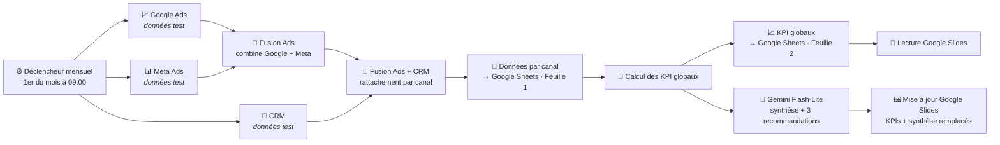

# Dashboard Marketing Mensuel — Canal+

**Automatisation complète du reporting marketing mensuel** : collecte des données Google Ads, Meta Ads et CRM, calcul des KPI, analyse assistée par IA (Google Gemini) et mise à jour automatique de Google Slides pour la revue client.

> ⚠️ **Statut : version de test** — Les trois sources de données sont pour l'instant des nœuds de données fictives (`noOp`). Les connecteurs finaux (Google Ads, Meta Ads, CRM) viendront se brancher exactement aux mêmes emplacements, sans modifier le reste du workflow.

---

## 🚀 Ce que fait le workflow

Tous les mois, le **1er à 09:00** (ou manuellement pour les tests), le workflow :

1. **Collecte** les données brutes des trois sources : budget, impressions, clics, visites, leads, ventes, mois, canal
2. **Consolide** : fusion des données Google Ads + Meta Ads, puis rapprochement avec le CRM **par canal**
3. **Calcule les KPI globaux** : budget total, impressions, clics, visites, leads, ventes, **coût par lead (CPL)**, **taux de conversion**, **taux de clic (CTR)**
4. **Analyse** les résultats via l'IA : une **synthèse de performance** et **3 recommandations** directement exploitables sont générées par Gemini (Flash-Lite)
5. **Rendu** : écriture des données dans Google Sheets (données par canal + KPI globaux) et **remplacement automatique du texte** de la présentation Google Slides (KPIs + synthèse IA)

## 🗺️ Architecture

**Déroulé en 4 étapes** (comme les sticky notes du workflow) :

| Étape | Objectif | Composants |
|---|---|---|
| **1 · Collecte** | Récupérer les données de performance marketing | Déclencheur planifié + 3 sources (Google Ads, Meta Ads, CRM) |
| **2 · Consolidation** | Fusionner les sources et calculer les KPI | 2 nœuds `merge` + nœud `code` de calcul |
| **3 · Stockage & dashboard** | Tracer les données mensuelles dans Google Sheets | `googleSheets` — Feuille 1 (données par canal, clé `canal`) et Feuille 2 (KPI globaux, clé `mois`), mode *Append or Update* |
| **4 · IA & reporting** | Produire l'analyse et mettre à jour la présentation | Gemini Flash-Lite + `googleSlides` (*replaceText* / *getSlides*) |

## 📂 Contenu du dépôt

- **`Workflow/`** — workflow **as-code** au format `workflow.ts` (SDK `@n8n/workflow-sdk`, importable directement dans n8n)
  - `Dashboard Canal+ - Test.workflow.ts` — le workflow du dashboard Canal+ (méthode : **1 seul workflow**)
- **`Skills/`** — skills **OpenCode** (format Agent Skills) utilisés pour la construction et la revue de ce projet
  - [`interview`](#-skills-opencode) — conduite d'entretien technique
  - [`doubt-driven-dev`](#-skills-opencode) — développement piloté par le doute méthodique
  - [`hostile-review`](#-skills-opencode) — revue de code façon attaquant hostile
- **`Video/`** — captures d'écran et exports / vidéos de démonstration du workflow

## 🛠️ Prérequis & configuration

- Une instance **n8n** (cloud ou auto-hébergée)
- **Crédentials** configurées dans n8n :
  - `Google Sheets - Stockage des données` *(OAuth2)*
  - `Google Slides - Génération du reporting` *(OAuth2)*
  - `Gemini API - Recommandations IA` *(clé API)*
- **Google Sheets « Dashboard Canal+ »** avec :
  - **Feuille 1** → données par canal (colonnes : `canal`, `mois`, `budget`, `impressions`, `clics`, `visites`, `leads`, `ventes`)
  - **Feuille 2** → KPI globaux (colonnes : `mois`, `budget_total`, `impressions_total`, `clics_total`, `visites_total`, `leads_total`, `ventes_total`, `cout_par_lead`, `taux_conversion`, `taux_clic`)
- **Google Slides template** contenant les **placeholders** remplacés à chaque exécution :
  `MOIS` · `BUDGET_GA` · `BUDGET_META` · `IMPRESSIONS` · `CLICS` · `VISITES` · `LEADS` · `VENTES` · `CPL` · `CONVERSION` · `CTR` · `BUDGET_TOTAL` · `SYNTHESE_IA`
- **Calendrier** : exécution automatique le **1er de chaque mois à 09:00**

## 🤖 Skills OpenCode

Ce dépôt embarque trois skills au format [Agent Skills](https://opencode.ai/docs), utilisés pour construire et éprouver le projet :

### `interview`
Conduite d'entretien technique ou parcours d'entretien complet : préparation de la grille d'évaluation (5–8 critères pondérés avec phrases de garde), banque de questions par catégorie (avec 3 niveaux de difficulté par question sérieuse), animation des phases (~45–60 min), notation à chaud sur barème à 5 niveaux ancrés, et compte-rendu argumenté avec grille, preuves, biais suspectés et verdict. Inclut des règles éthiques strictes.

### `doubt-driven-dev`
Développement piloté par le doute méthodique : chaque « je crois que » devient une hypothèse testable (`[D1] …`), triée (bloquant / coûteux / cosmétique / supposé), tranchée par une boucle de validation frugale (lire le code source → petite expérience → staging → humain, dans cet ordre de coût) — et seulement ensuite, le codage. Journal des doutes tenu par session, avec 5 anti-patterns explicites (douter vaguement, sur-tester les évidences, coder pour connaître, doute zombie…).

### `hostile-review`
Revue de code comme une attaque hostile : ton adversaire assumé, checklist de surfaces d'attaque (injection, endpoints publics, secrets, XSS/CSRF/SSRF/IDOR, fiabilité, permissions, erreurs), chaque trou étayé d'une **preuve** et coté par risque (blocker → low) avec coût d'attaque vs coût de remédiation, et vérification de régression systématique. Hostilité dirigée contre le code, jamais contre la personne ; activation signalée sur les travaux personnels ou tiers.

## 🎬 Vidéos & exports

Le dossier [`Video/`](Video) accueille les captures d'écran et les exports vidéo de démonstration du workflow.

---

*Projet : Inès Soubran — dashboard marketing mensuel Canal+ · n8n · OpenCode*
